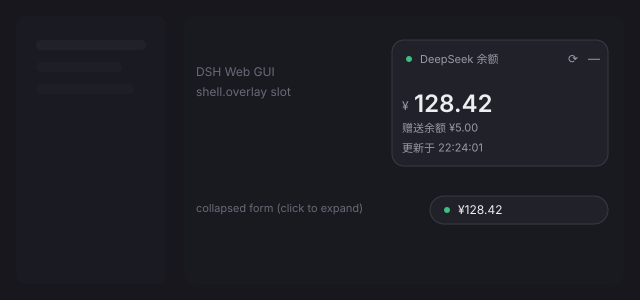

# dsh-deepseek-balance-float

A floating card inside the [DSH](https://github.com/deepseek-ai/deepseek-harness)
Web GUI that shows the signed-in DeepSeek account balance — read through DSH's
own account Remote, with **no API key**.



```text
┌─────────────────────────┐
│ ● DeepSeek 余额      ⟳ —│
│ ¥128.420                │
│ 赠送余额 ¥5.000         │
│ 更新于 23:04:11         │
└─────────────────────────┘
```

## Features

* **Floating overlay card** in the frame-wide `shell.overlay` slot: it sits above
  every column, never replaces shipped UI, and can be collapsed to a one-line
  pill.
* **Uses DSH's own account data.** The balance comes from the generated
  `ctx.remote.account.getBalance` Remote (`@deepseek-ai/dsh-api-account-controller`),
  the same source as Settings → Account. Nothing is sent to a third party, no
  token is stored or read, and nothing is written to disk.
* **Auto-refresh every 10 seconds** while the card is open, and a read already in
  flight is never doubled up.
* **Left-click the card to refresh** immediately. A click that ended a drag is
  ignored, so dragging never triggers a read.
* **Fixed three-decimal amounts** (`42.50` → `42.500`, `1.2394` → `1.239`), so the
  card's width never jumps between refreshes.
* **Drag by the header**, geometry clamped to the viewport; position and
  collapsed/expanded state persist in `localStorage`.
* **Follows the active theme** through `--dsw-*` tokens, light and dark.
* **Low-balance hint**: an amount at or below ¥10 is drawn in the error colour.
* **Zero dependencies, zero build step.** `lib/client.js` is the artifact DSH
  loads; CI only runs a syntax check and the offline contract test.

## Requirements

* DSH 0.2.x with the Web GUI (Desktop app or `dsh web`).
* A Host that mounts `@deepseek-ai/dsh-api-account-controller` (shipped in the
  default composition) and a signed-in DeepSeek account.

## Install

Add the package to a DSH profile as a local dependency and mount its bundle:

```jsonc
// ~/.dsh/profiles/<profile>/package.json
{
  "dependencies": {
    "dsh-deepseek-balance-float": "file:<path to this checkout>"
  },
  "dsh": {
    "profile": {
      "bundles": [
        // ... the profile's existing bundles
        "dsh-deepseek-balance-float"
      ]
    }
  }
}
```

```powershell
node <pnpm.mjs> install --dir "$env:USERPROFILE\.dsh\profiles\<profile>"
```

> **pnpm materializes a `file:` dependency as a private copy** (hardlinked files
> under `node_modules/<name>`), so editing the checkout changes nothing that DSH
> reads. Replace the copy with a junction to always serve the source:
>
> ```powershell
> $link   = "$env:USERPROFILE\.dsh\profiles\<profile>\node_modules\dsh-deepseek-balance-float"
> $target = "<path to this checkout>"
> Remove-Item -Recurse -Force $link
> New-Item -ItemType Junction -Path $link -Target $target
> ```

Then **restart DSH** — a Desktop profile composes its patch layers at start, so a
newly added bundle mounts on the next launch. Reload the GUI page and the card
appears near the top-right of the frame.

## Usage

| Action | Effect |
|---|---|
| Left-click the card | Refresh the balance now |
| ⟳ button | Same as above |
| Drag the header | Move the card (clamped to the viewport) |
| `—` button | Collapse to the one-line pill |
| Click the pill | Expand the card again |

## How it works

| Path | Role |
|---|---|
| [`lib/client.js`](lib/client.js) | The whole widget. A hand-written `window.__ModuleLoader__` browser bundle that registers exactly one occupant into the `shell.overlay` slot. It requires only the platform `react` module, so no bundler or build step is involved. |
| [`lib/index.js`](lib/index.js) | The Host half. Deliberately inert (`apply(){}`, `inject: []`): the widget needs no Host route, service or Remote of its own. It exists so the package is a real DSH Loader entry, which is what makes the client bundle publishable. |
| [`cordis.patch.yml`](cordis.patch.yml) | The bundle layer: one mount row, plus a guard that disables the row when the same package is already mounted by hand (no double registration). |
| [`test/contract.mjs`](test/contract.mjs) | Offline contract check. Boots `lib/client.js` under a stubbed `__ModuleLoader__`, drives `apply(ctx)`, renders the tree, checks the amount formatting and the read path, then repeats the mount **with no DOM and no services**. |

### Boot-failure contract

DSH's Web shell audits every enabled Loader entry once the tree settles, and a
client entry that is not `active` **fails the whole web boot** — the GUI shows
"Failed to load plugins" and never starts. Two rules follow:

* `apply()` must never throw and must never await anything that can reject. Its
  body is wrapped in `try`/`catch`, and every browser API it touches
  (`document`, `document.head`, `localStorage`, pointer capture) is optional. The
  first version of this widget called `document.head.appendChild` unguarded
  during activation and took the application down.
* The Host half stays inert, so it cannot depend on a service, a logger, or an
  ordering fact at mount time.

If a mount ever does break startup, remove the bundle and restart:

```powershell
pwsh -File scripts/unmount.ps1 -Profile desktop
```

## Development

No build, no dependencies:

```bash
node test/contract.mjs     # or: npm test
node --check lib/client.js
```

`test/contract.mjs` runs against the real `lib/client.js` under a stubbed module
loader, so it needs neither Node modules nor a running DSH.

## Troubleshooting

| Symptom | Cause and fix |
|---|---|
| GUI shows "Failed to load plugins" | A client entry failed activation. Run `scripts/unmount.ps1`, restart, and check the crash log under `%APPDATA%\@deepseek-ai\dsh-desktop\logs\`. |
| Card missing after a restart | The bundle is not in `dsh.profile.bundles`, or the profile was not restarted after adding it. |
| Edits to the source have no effect | `node_modules/<name>` is still pnpm's private copy. Replace it with a junction (see Install); compare file sizes/hashes to confirm. |
| Card shows “账号服务不可用” | The Host has no account Remote mounted, or no account is signed in. |
| Card shows “读取失败，点击刷新重试” | The Remote call was refused (usually not signed in); click the card to retry. |

## License

[MIT](LICENSE)
